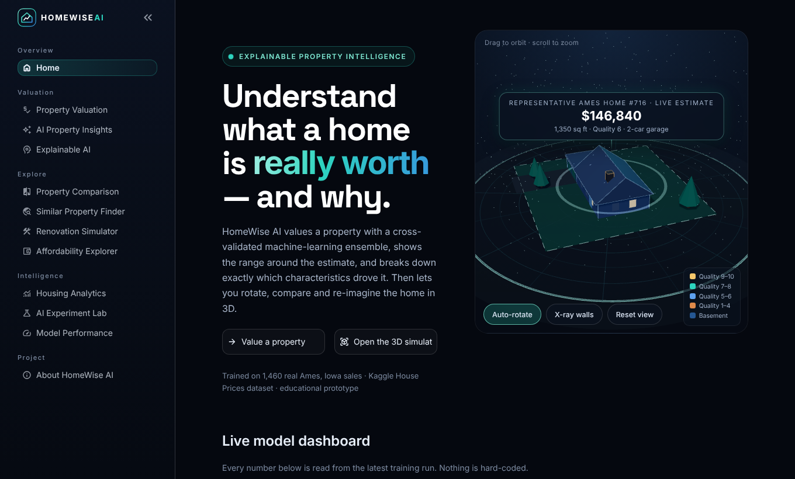
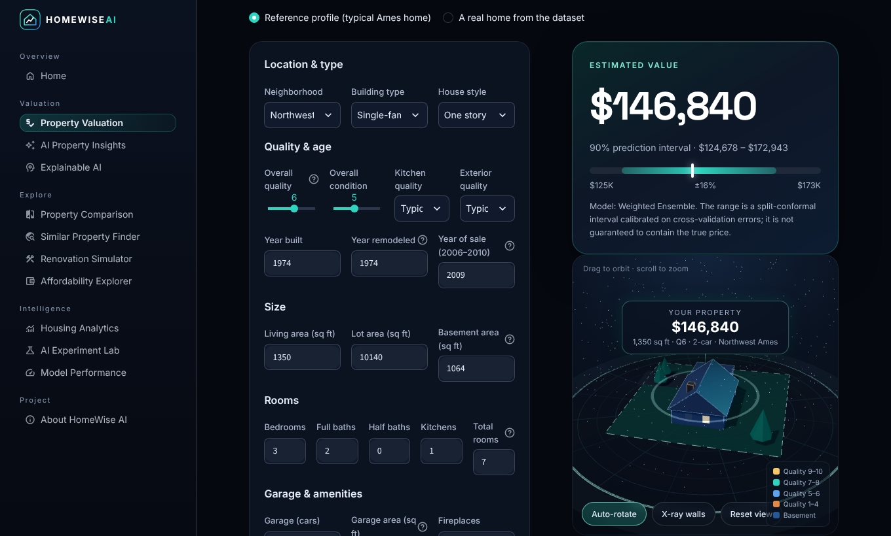
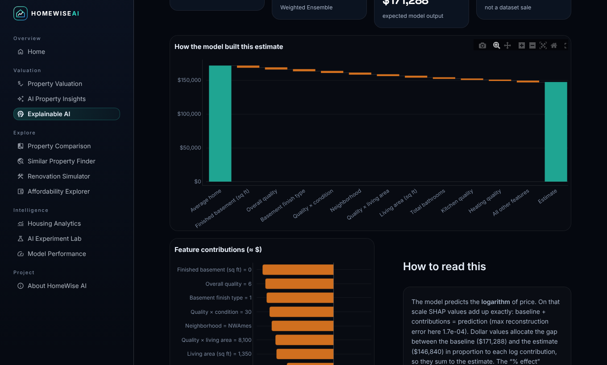
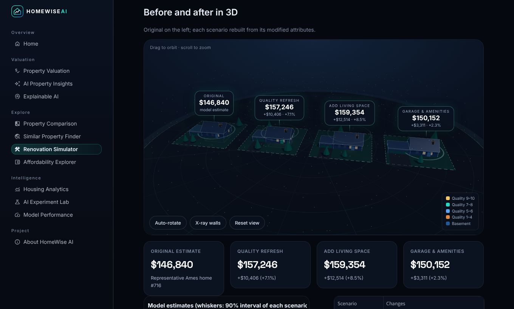
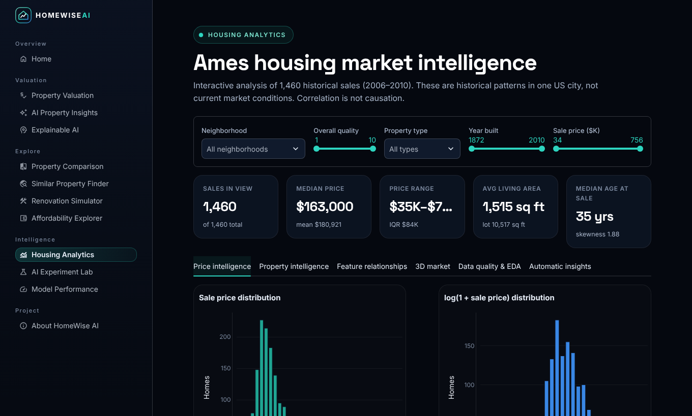
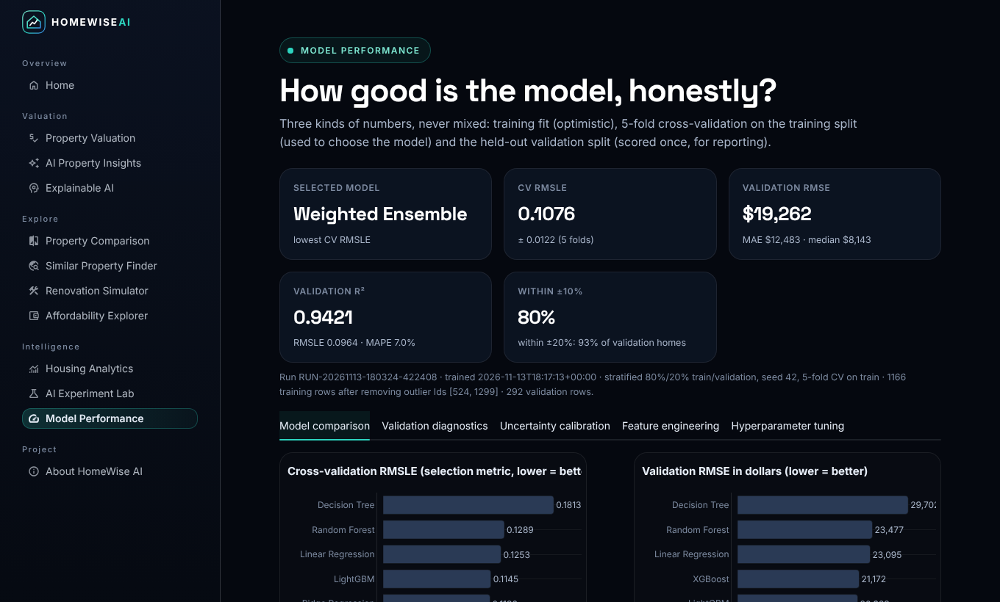

# HOMEWISE AI

**Understand Property Value. Discover What Drives It. Make Smarter Housing Decisions.**

HomeWise AI is an explainable property-valuation and housing-analytics platform. It estimates a home's price with a
cross-validated machine-learning ensemble, shows a calibrated range around the estimate, explains exactly which
characteristics drove it, and lets you compare, re-imagine and explore homes, including interactive **3D property
twins** rebuilt from each home's attributes and a **3D market galaxy** of every recorded sale.

> Research and educational prototype trained on historical sales from Ames, Iowa (2006–2010). It is not an
> appraisal, does not reflect today's market, and cannot value homes in other cities or countries.

---

## Contents

1. [Real-world problem](#1-real-world-problem) · 2. [Objectives](#2-objectives) · 3. [Dataset](#3-dataset) ·
4. [Dataset limitations](#4-dataset-limitations) · 5. [Technology stack](#5-technology-stack) ·
6. [ML workflow](#6-machine-learning-workflow) · 7. [EDA](#7-exploratory-data-analysis) ·
8. [Preprocessing](#8-preprocessing-methodology) · 9. [Feature engineering](#9-feature-engineering) ·
10. [Models](#10-models-implemented) · 11. [Hyperparameter optimisation](#11-hyperparameter-optimisation) ·
12. [Evaluation](#12-evaluation-methodology-and-results) · 13. [Explainable AI](#13-explainable-ai) ·
14. [Uncertainty](#14-prediction-uncertainty) · 15. [Renovation simulator](#15-renovation-simulator) ·
16. [Similar homes](#16-similar-property-finder) · 17. [Affordability](#17-affordability-explorer) ·
18. [Architecture](#18-application-architecture) · 19. [Installation (Windows)](#19-installation-windows) ·
20. [Dataset setup](#20-dataset-setup) · 21. [Training](#21-model-training) · 22. [Launch](#22-launch-the-application) ·
23. [Testing](#23-testing) · 24. [Limitations](#24-limitations) · 25. [Future improvements](#25-future-improvements) ·
26. [License](#26-license)

---

## Quick start

```bash
git clone https://github.com/aarushagrawal267-maker/homewise-ai.git
cd homewise-ai
git checkout claude/project-completion   # only needed until this branch is merged into main
python -m venv .venv && source .venv/bin/activate   # Windows: .venv\Scripts\activate
pip install -r requirements-dev.txt
python scripts/download_data.py    # fetches the checksum-verified Kaggle CSVs into data/raw/
pytest                             # 80 tests
streamlit run app.py               # open http://localhost:8501
```

The trained models are already committed, so no training is needed. Windows step-by-step instructions are in
[§19](#19-installation-windows).

## Screenshots

| Home with live 3D twin | Property valuation with 90% interval |
|---|---|
|  |  |
| **Explainable AI (SHAP waterfall)** | **Renovation simulator, before and after in 3D** |
|  |  |
| **Housing analytics** | **Model performance** |
|  |  |

---

## 1. Real-world problem

Two houses in the same neighbourhood can sell for very different prices because of living area, construction
quality, condition, age, renovations, basements, garages and layout. A single predicted number does not explain
those differences, hides how uncertain it is, and says nothing about how the estimate would respond if the home were
different. HomeWise AI turns a valuation into something you can **understand, question and explore**.

## 2. Objectives

* Predict sale prices from property characteristics with a rigorously validated model.
* Explain every prediction (exact SHAP contributions) and the model overall (SHAP, permutation importance, PDP/ICE).
* Quantify uncertainty with prediction intervals whose coverage is checked on held-out data.
* Compare properties, find similar historical sales and simulate hypothetical changes.
* Provide illustrative affordability maths that is kept separate from the ML model.
* Deliver all of this in a polished, interactive web app that runs on an ordinary Windows laptop.

## 3. Dataset

**Kaggle — House Prices: Advanced Regression Techniques**
<https://www.kaggle.com/competitions/house-prices-advanced-regression-techniques/data>
(derived from Dean De Cock's Ames, Iowa housing data, *Journal of Statistics Education*, 2011).

| File | Rows | Columns | Notes |
|---|---|---|---|
| `train.csv` | 1,460 | 81 | 79 features + `Id` + target `SalePrice` |
| `test.csv` | 1,459 | 80 | no `SalePrice`; used only for submission-style inference |
| `data_description.txt` | — | — | optional; a built-in copy of the feature dictionary is used when absent |

Sales took place from 2006 to 2010. The features are 35 numerical and 44 categorical. `MSSubClass` is numerically
coded but treated as a category.

**Acquisition.** `scripts/download_data.py` tries, in order:

1. files you placed in `data/raw/`;
2. the Kaggle API (`kaggle competitions download`), when it is installed and configured;
3. a public mirror of the identical competition files hosted by the *Dive into Deep Learning* textbook (d2l.ai).

The mirror is accepted only if the MD5 checksums match `train.csv` `80ccab65…` and `test.csv` `dcec4b79…`. The files
are 460,676 and 451,405 bytes, matching the sizes listed on the Kaggle page. They also reproduce the published
statistics: 1,460 rows with mean SalePrice $180,921 and median $163,000, and test Ids 1461–2919. The raw files are
never modified, and they are not committed to this repository.

## 4. Dataset limitations

* **One city, one period.** Ames, Iowa, 2006–2010 (including the 2008 financial crisis). The model must not be used
  for Bengaluru, Mumbai, London or any other market, nor for current prices.
* **Small sample.** 1,460 sales; rare property types (very large, very old, unusual neighbourhoods) have few examples.
* **Observational data.** Learned relationships are associations, not causal effects.
* **Sparse features.** Pools exist in 7 sales and some neighbourhoods have under 10 sales.

## 5. Technology stack

| Area | Tools |
|---|---|
| Language | Python 3.11 / 3.12 |
| Data | pandas, NumPy, SciPy, statsmodels |
| ML | scikit-learn (Pipelines, ColumnTransformer, linear models, trees, RF, GBM, voting & stacking), XGBoost, LightGBM |
| Tuning | GridSearchCV, RandomizedSearchCV, Optuna (TPE) |
| Explainability | SHAP (TreeSHAP / exact linear), permutation importance, partial dependence + ICE |
| Visualisation | Plotly (interactive), Matplotlib & Seaborn (static report figures), Three.js (WebGL 3D) |
| App | Streamlit with a custom CSS design system, multipage navigation, cached resources |
| Persistence & tests | joblib, JSON-Lines experiment log, pytest |

## 6. Machine learning workflow

```
train.csv ─► validation ─► stratified 80/20 split (seed 42) ─► 2 documented outliers removed from TRAIN only
          │                     │
          │                     └─► validation split (292 homes): untouched until final scoring
          ▼
  training split (1,166) ─► feature-engineering ablation (5-fold CV)
                         ─► per-model tuning (5-fold CV inside the training split)
                         ─► out-of-fold predictions per tuned model
                         ─► weighted & stacking ensembles from the 4 best CV models
                         ─► model SELECTION by CV RMSLE only
                         ─► single evaluation of every model on the validation split (reporting)
                         ─► conformal intervals (OOF residuals) · SHAP · permutation importance · PDP
                         ─► models/homewise_model.joblib + outputs/reports/*
test.csv ─► inference only ─► outputs/submission.csv (Kaggle format: Id,SalePrice)
```

Every model is a single scikit-learn object:
`TransformedTargetRegressor(Pipeline([DomainCleaner, FeatureEngineer, ColumnTransformer, model]), log1p/expm1)`.
It takes raw Kaggle-format rows and returns dollars, so **training and serving share the exact same
transformations** (verified by tests).

## 7. Exploratory data analysis

Implemented in `src/eda.py`, the **Housing Analytics** page and `notebooks/housing_exploration.ipynb`. Fourteen
static figures are written to `outputs/figures/`. Selected findings, all computed from the data:

* SalePrice: mean $180,921, median $163,000, min $34,900, max $755,000, SD $79,443, IQR $129,975–$214,000.
  Skewness is **1.88**, falling to **0.12** after `log1p`, which motivates a log-price target.
* Strongest numeric correlations with price: OverallQual (0.79), GrLivArea (0.71), GarageCars (0.64), GarageArea
  (0.62), TotalBsmtSF (0.61).
* Median price rises from $50,150 at quality 1 to $432,390 at quality 10 (Spearman 0.81).
* Homes built in 2000 or later have a median of $223,750, against $122,000 for homes built before 1950. Newer homes
  are also larger and better built, so age alone does not explain the gap.
* Highest median neighbourhoods (≥10 sales): Northridge Heights ($315,000), Northridge ($301,500), Stone Brook
  ($278,000). Lowest: Briardale ($106,000), Iowa DOT & Rail Road ($103,000), Meadow Village ($88,000).
* 7,829 missing cells across 19 columns, mostly "feature absent" (PoolQC 99.5%, MiscFeature 96.3%, Alley 93.8%).
  There are no duplicate records.
* Homes 524 and 1299 have more than 4,000 sq ft yet sold for under $200K (both *Partial* sales). These are the
  outliers the dataset author warns about.

## 8. Preprocessing methodology

* **Data-dictionary missing values** (`src/preprocessing.py`):
  * For 15 descriptors (basement, garage, fireplace, pool, fence, alley, misc, masonry type), NA means the feature
    is absent and becomes `"None"`.
  * The matching areas and counts become 0.
  * A missing `GarageYrBlt` (no garage) takes the house's build year, and the `HasGarage` flag records the absence.
* **Ordinal quality scales** (Ex > Gd > TA > Fa > Po > None, basement exposure and finish types, garage finish,
  functionality) are mapped to ordered integers.
* **Fitted steps live inside the pipeline**, so they are fitted on training rows or CV-fold rows only:
  * median imputation for numeric columns (e.g. LotFrontage) and most-frequent for categorical ones;
  * one-hot encoding with `handle_unknown="ignore"`;
  * for linear models only, a skewness-based `log1p` (|skew| > 0.75, learned on training data) and standard scaling.
* **Outliers**: the two partial-sale outliers are removed from the training split only. Validation is never filtered.
* **Leakage tests** check that the imputer statistics depend only on training rows and that the splits are disjoint
  and reproducible.

## 9. Feature engineering

Nineteen stateless features in four groups (`src/feature_engineering.py`), each with a documented rationale:

| Group | Features |
|---|---|
| size | TotalSF, TotalBathrooms, TotalPorchSF, LivingLotRatio, AreaPerGarageCar |
| age | HouseAge, YearsSinceRemodel, GarageAge, WasRemodeled |
| quality | QualityCondition, QualityArea, QualityBand, ConditionBand |
| facilities | HasGarage, HasBasement, HasFireplace, HasPool, HasCentralAir, Has2ndFloor |

**Ablation** (5-fold CV RMSLE on the training split, lower is better):

| Configuration | Ridge | LightGBM |
|---|---|---|
| no engineered features | 0.1154 | 0.1201 |
| all engineered features | **0.1136** | **0.1178** |
| without *size* | 0.1136 | 0.1191 |
| without *age* | 0.1136 | 0.1184 |
| without *quality* | 0.1154 | 0.1190 |
| without *facilities* | 0.1135 | 0.1182 |

Engineered features help both models. The *quality* interactions matter most for Ridge, while LightGBM benefits from
every group. Fold-to-fold SD (about 0.012) exceeds most single-group differences, so individual group effects are
suggestive rather than conclusive.

## 10. Models implemented

Linear Regression (baseline), Ridge, Lasso, Decision Tree, Random Forest, Gradient Boosting, XGBoost, LightGBM, a
**weighted ensemble** (non-negative weights summing to 1, optimised on out-of-fold log predictions) and a **stacking
ensemble** (RidgeCV meta-learner). XGBoost and LightGBM are optional: if either fails to import, it is skipped
without breaking the app.

## 11. Hyperparameter optimisation

All searches use 5-fold CV inside the training split, scored by RMSLE (`src/hyperparameter_tuning.py`):

| Model | Method | Candidates | Best parameters |
|---|---|---|---|
| Ridge | GridSearchCV | 11 | α = 10 |
| Lasso | GridSearchCV | 8 | α = 0.0005 |
| Decision Tree | GridSearchCV | 30 | max_depth = None, min_samples_leaf = 10 |
| Random Forest | RandomizedSearchCV | 12 | 300 trees, max_features 0.2, max_depth 25 |
| Gradient Boosting | Optuna TPE | 20 | 1000 trees, lr 0.077, depth 2, subsample 0.96 |
| XGBoost | Optuna TPE | 25 | 1000 trees, lr 0.022, depth 3, colsample 0.28 |
| LightGBM | Optuna TPE | 25 | 2100 trees, lr 0.0084, 21 leaves, colsample 0.16 |

A full run takes about 14 minutes on a 4-core CPU, and `--quick` divides the search budgets by three. Every result
is logged to the append-only `outputs/experiments/experiments.jsonl`.

## 12. Evaluation methodology and results

The report keeps three kinds of number separate:

* **Training fit** is optimistic.
* **5-fold CV on the training split** is the only basis for model selection.
* **The held-out validation split** (292 homes) is scored once, for reporting only.

Errors are in dollars after inverse-transforming log predictions. These are the actual results of run
`RUN-20261113-180324-422408`, from `outputs/reports/model_comparison.csv`:

| Model | CV RMSLE (± SD) | Val MAE | Val RMSE | Val R² | Val RMSLE | Train time |
|---|---|---|---|---|---|---|
| **Weighted Ensemble** (selected) | **0.1076 ± 0.0122** | **$12,483** | **$19,262** | **0.9421** | **0.0964** | 6.4 s |
| Stacking Ensemble | 0.1088 ± 0.0122 | $12,551 | $19,310 | 0.9418 | 0.0974 | 31.3 s |
| Lasso | 0.1113 ± 0.0130 | $13,309 | $20,294 | 0.9358 | 0.0977 | 0.17 s |
| XGBoost | 0.1132 ± 0.0109 | $13,571 | $21,172 | 0.9301 | 0.1090 | 0.73 s |
| Gradient Boosting | 0.1136 ± 0.0090 | $12,833 | $19,723 | 0.9393 | 0.1046 | 5.0 s |
| Ridge | 0.1136 ± 0.0138 | $13,423 | $20,272 | 0.9359 | 0.0993 | 0.10 s |
| LightGBM | 0.1145 ± 0.0121 | $13,060 | $20,923 | 0.9317 | 0.1107 | 1.6 s |
| Linear Regression | 0.1253 ± 0.0071 | $15,410 | $23,095 | 0.9168 | 0.1289 | 0.11 s |
| Random Forest | 0.1289 ± 0.0125 | $14,410 | $23,477 | 0.9140 | 0.1219 | 1.5 s |
| Decision Tree | 0.1813 ± 0.0118 | $19,978 | $29,702 | 0.8624 | 0.1508 | 0.11 s |

The selected ensemble combines Lasso (0.503), Gradient Boosting (0.371) and XGBoost (0.125); Ridge received weight
0. On validation:

* median absolute error is $8,143 and MAPE is 7.0%;
* 79.8% of homes are within ±10% of their sale price, and 93.5% within ±20%.

The ensemble beats every single model in CV. Its CV score is slightly optimistic, because its weights were fitted on
the same out-of-fold predictions: re-fitting the weights inside each fold, without that fold, gives 0.1080 instead of
0.1076, which still ranks it first. All CV scores also carry a little selection optimism, because each model's
hyperparameters were chosen on the same five folds. The validation split gives the unbiased check.

**Baselines and precision** (`python scripts/audit_metrics.py`, which re-scores the saved models, confirms every
number in the table above and writes `outputs/reports/metric_audit.json`):

| Reference on the same validation split | Val RMSLE | Val MAE | Val R² |
|---|---|---|---|
| Training median price for every home | 0.4099 | $55,819 | −0.049 |
| Neighbourhood median price | 0.2892 | $38,445 | 0.476 |
| Log-linear on living area + quality (2 features) | 0.1864 | $25,484 | 0.782 |
| **Weighted Ensemble** (selected) | **0.0964** | **$12,483** | **0.942** |

* 95% bootstrap intervals for the selected model over the 292 validation homes: RMSLE 0.085–0.108, MAE
  $10,838 to $14,308, RMSE $15,567 to $23,291, R² 0.922–0.960, share within ±10% 75.3%–84.2%.
* Paired bootstrap of the RMSLE gap on the same homes: −0.0013 against Lasso (95% CI −0.0053 to +0.0030) and −0.0010
  against the stacking ensemble (−0.0023 to +0.0001). Both intervals include 0, so validation **cannot separate** the
  ensemble from Lasso or stacking; the top models are effectively tied. The gap to the baselines is far larger
  than this noise.
* Validation RMSLE (0.096) is below CV RMSLE (0.108). The validation interval reaches 0.108, and the final model is
  trained on all 1,166 training homes while each CV model sees only about 933, so this is sampling noise plus more
  training data, not leakage.

## 13. Explainable AI

* **Exact SHAP contributions** in log-price space: TreeSHAP for tree models and closed-form contributions for
  linear models. For ensembles they are combined with the ensemble weights, or the stacking meta-coefficients.
  One-hot columns are summed back to their source characteristic. The maximum reconstruction error is
  1.7 × 10⁻⁴ log units.
* **Dollar view:** each feature's share of the gap between the baseline and the estimate, proportional to its log
  contribution. The exact multiplicative effect is also shown.
* **Global views:** SHAP summary (beeswarm), mean |SHAP|, permutation importance on the validation split (raw
  columns, RMSLE), and partial dependence with ICE curves for six features. The app also has a **3D two-way
  partial-dependence price surface** (living area × quality).
* **Top drivers:**
  * Mean |SHAP|: TotalSF, GrLivArea, Quality × Area, Quality × Condition, OverallQual, TotalBathrooms, HouseAge.
  * Permutation importance: OverallQual, GrLivArea, TotalBsmtSF, YearBuilt, LotArea, OverallCond.

All of these describe the model's associations, **not causal effects**.

## 14. Prediction uncertainty

Split-conformal intervals on the log scale use absolute out-of-fold residuals of the selected model, with the
finite-sample quantile ⌈(n+1)(1−α)⌉. Coverage measured on the untouched validation split:

| Target | Achieved (95% CI) | Range around the estimate | Median width (% of estimate) |
|---|---|---|---|
| 80% | 81.8% (77.4–86.0%) | −10.4% / +11.6% | 22.0% |
| 90% | 90.4% (87.0–93.5%) | −15.1% / +17.8% | 32.9% |
| 95% | 95.2% (92.5–97.6%) | −19.4% / +24.1% | 43.6% |

Because the interval is symmetric on the log scale, it is slightly wider above the estimate than below it.

Coverage is a marginal, on-average property for homes like those in the data. It is **not guaranteed** for any
individual home or for homes unlike the training data. The app also warns when inputs fall outside the training
range.

## 15. Renovation simulator

The **Property Value Simulator** takes a base home (yours or a real one) and up to three scenarios, changing quality,
living area, basement, garage, bathrooms, kitchen quality, remodel year, fireplaces, central air and pool. For each
scenario it shows:

* the original and modified estimates, the $ and % difference, and each scenario's 90% interval;
* every changed model input, the shift in SHAP contributions and a sensitivity curve;
* a **side-by-side 3D before/after scene**.

Related fields are kept consistent: more living area rescales the floor areas, and removing a garage clears its
attributes. It is labelled as a *hypothetical model-based scenario*. There are no renovation costs and no ROI claims.

## 16. Similar property finder

Nearest neighbours over standardised, weighted structural features (living area, total area, quality, condition,
age, bathrooms, bedrooms, garage, log lot area, rooms) plus one-hot neighbourhood and building type. It returns real
historical sales with their recorded prices, similarity scores (0–100), the features that set the home apart, and a
3D scene of the home beside its three closest matches. These are historical comparisons, **not live listings**.

## 17. Affordability explorer

Standard amortising loan: M = P·r / (1 − (1+r)^−n). It calculates the loan amount, instalment, down-payment %,
payment-to-income, total repayment and total interest, plus a yearly schedule, a balance curve and rate sensitivity.
It is mathematically separate from the ML model and labelled as illustrative: not an approval, offer or financial
advice.

## 18. Application architecture

```
homewise-ai/
├── app.py                     # entry point: theme, logo, grouped navigation
├── pages/                     # 12 pages (0_Home … 11_About)
├── src/
│   ├── config.py              # config.yaml + OS-independent paths
│   ├── data_loader.py         # acquisition (local / Kaggle API / checksum-verified mirror), loading
│   ├── data_validation.py     # schema, target, missing, duplicates, feature types, train/test checks
│   ├── data_dictionary.py     # feature descriptions, NA semantics, friendly names
│   ├── eda.py                 # statistics, automatic insights, static figures
│   ├── preprocessing.py       # DomainCleaner, SkewLog1p, ColumnTransformer, split, outliers
│   ├── feature_engineering.py # FeatureEngineer (stateless, toggleable groups)
│   ├── models.py              # registry, pipelines, weighted & stacking ensembles
│   ├── hyperparameter_tuning.py
│   ├── train.py               # end-to-end orchestration
│   ├── evaluate.py            # metrics, OOF cross-validation, timing
│   ├── explainability.py      # exact SHAP for pipelines & ensembles, permutation, PDP/ICE
│   ├── uncertainty.py         # split-conformal intervals and coverage
│   ├── prediction.py          # input validation, consistent record building, PredictionEngine
│   ├── property_comparison.py · similar_properties.py · renovation_simulator.py · affordability.py
│   ├── experiment_tracker.py  # append-only JSONL log
│   ├── visualization.py       # Plotly chart system (validated colour palette)
│   ├── three_scenes.py        # Three.js 3D house twins & market galaxy
│   └── ui.py                  # design system, cached resources, shared form & components
├── scripts/  download_data.py · train_all.py · audit_metrics.py · build_notebook.py
├── static/vendor/three/       # Three.js (MIT), served locally → 3D works offline
├── assets/   styles/main.css · images/logo.svg · icons/mark.svg
├── data/raw/ (Kaggle CSVs, git-ignored) · data/processed/ (split Ids)
├── models/   homewise_model.joblib · candidates/*.joblib
├── outputs/  figures/ · reports/ · experiments/experiments.jsonl · submission.csv
├── notebooks/housing_exploration.ipynb
├── tests/    8 test modules (80 tests)
├── docs/screenshots/          # images used in this README
├── .github/workflows/tests.yml # CI: downloads the data and runs pytest on every push
├── Dockerfile · DEPLOYMENT.md · requirements-dev.txt · LICENSE
├── config.yaml · requirements.txt · README.md · PROJECT_REPORT.md
```

**Caching.** The model bundle, explainer and nearest-neighbour index are `st.cache_resource` objects, and datasets
and reports are `st.cache_data`. The app **never retrains on refresh**.

## 19. Installation (Windows)

You need Python 3.11 or 3.12 (64-bit, from python.org; tick *Add python.exe to PATH*) and Git. In **PowerShell**:

```powershell
git clone https://github.com/aarushagrawal267-maker/homewise-ai.git
cd homewise-ai
git checkout claude/project-completion   # only needed until this branch is merged into main
py -3.11 -m venv .venv
.venv\Scripts\Activate.ps1
python -m pip install --upgrade pip
pip install -r requirements-dev.txt
```

`requirements-dev.txt` adds pytest and the notebook tools to the runtime requirements in `requirements.txt`. If PowerShell blocks the activation script, run `Set-ExecutionPolicy -Scope Process -ExecutionPolicy Bypass` and
activate again. In Command Prompt use `.venv\Scripts\activate.bat`. Replace `3.11` with `3.12` if that is what you
installed. The versions are pinned because the saved models were trained with them.

## 20. Dataset setup

```powershell
python scripts/download_data.py
```

To download manually instead:

1. Open the [Kaggle data page](https://www.kaggle.com/competitions/house-prices-advanced-regression-techniques/data),
   sign in and accept the rules.
2. Click *Download All* and unzip.
3. Copy `train.csv`, `test.csv` and `data_description.txt` into `data\raw\`.

The app detects the files automatically and validates them.

## 21. Model training

The trained models are already included in `models/`, so this step is **optional**:

```powershell
python scripts/train_all.py          # full run, about 15 min on a 4-core laptop CPU
python scripts/train_all.py --quick  # smaller search budgets, about 5 min
```

The run regenerates `models/`, `outputs/reports/`, `outputs/figures/` and `outputs/submission.csv`, and appends to
the experiment log. To rebuild the notebook, run `python scripts/build_notebook.py`.

To check the reported numbers without retraining, run `python scripts/audit_metrics.py` (about 30 seconds). It
re-scores the saved models on the validation split, exits with an error if any number in
`outputs/reports/training_summary.json` or `model_comparison.csv` does not match, and adds baselines and bootstrap
confidence intervals in `outputs/reports/metric_audit.json`. After a new training run, re-run it so the Model
Performance page shows intervals for the new run.

## 22. Launch the application

To put the app online (Streamlit Community Cloud, Hugging Face Spaces, Render or Docker), see
[DEPLOYMENT.md](DEPLOYMENT.md). On a fresh server the app downloads the dataset automatically on first launch.


```powershell
streamlit run app.py
```

Then open <http://localhost:8501>. Three.js is served locally, so the 3D views work offline. Fonts fall back to
system fonts when offline.

## 23. Testing

```powershell
python scripts/download_data.py   # once: the data-dependent tests skip themselves if data/raw is empty
pytest
```

The suite has 80 tests in 8 modules covering:

* CSV loading, checksums and schema, target, missing-value, duplicate and type checks;
* NA-means-absent handling, unseen categories, the skew transform, split reproducibility and **no leakage**;
* engineered-feature correctness;
* every model's training, prediction, saving, loading and **seed reproducibility**;
* valid, invalid and missing inputs, the **inverse transform** and **identical training/serving pipelines**;
* consistency rules, extrapolation warnings and conformal coverage;
* SHAP additivity for linear, tree and ensemble models, permutation importance and PDP;
* affordability against a known amortisation value ($200K at 6% over 30 years = $1,199.10 a month);
* the simulator, comparison, similar homes, 3D scene generation, the append-only experiment log and engine caching.

## 24. Limitations

* Valid only for Ames, Iowa sales from 2006 to 2010. Estimates are model outputs, not appraisals.
* Contributions, partial dependence and simulator differences are associations, not causal effects.
* Accuracy is lower for rare homes. Abnormal and family sales have median errors around 10%, against 4.7% for
  normal sales.
* Fields the form does not ask for come from the most representative real sale (#716) or from the home you started
  from. This can matter for homes that differ a lot from those defaults.
* The weighted ensemble's CV score is slightly optimistic (by about 0.0004 RMSLE, see §12), and every CV score carries
  some hyperparameter-selection optimism. Interval coverage is marginal, not per-home.
* The validation split has only 292 homes, so its metrics carry real sampling error (RMSLE 95% CI 0.085–0.108). The
  top three models cannot be told apart on it.
* The split is random, not by date. Sales from 2006 to 2010 are mixed in both sets, so these scores do not measure
  how the model would hold up on later sales.
* The 3D houses are stylised: their geometry is driven by the data but they are not architectural models.

## 25. Future improvements

* Nested cross-validation for fully unbiased ensemble scores, and a locally adaptive (normalised) conformal method.
* Monotonic constraints (e.g. price non-decreasing in quality and area) for more plausible simulator responses.
* Geospatial features if coordinates become available, and time-aware validation across sale years.
* Retraining on larger, more recent and more diverse datasets with appropriate licensing.
* Model cards and fairness checks across neighbourhoods.

## 26. License

The source code is released under the [MIT License](LICENSE). Three.js in `static/vendor/three/` is also MIT
licensed (see its own `LICENSE`). The Kaggle dataset is **not** included in this repository and remains subject to
the competition's rules; `scripts/download_data.py` fetches it for local use.
